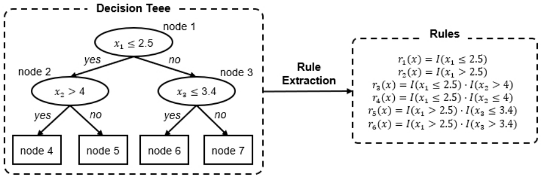
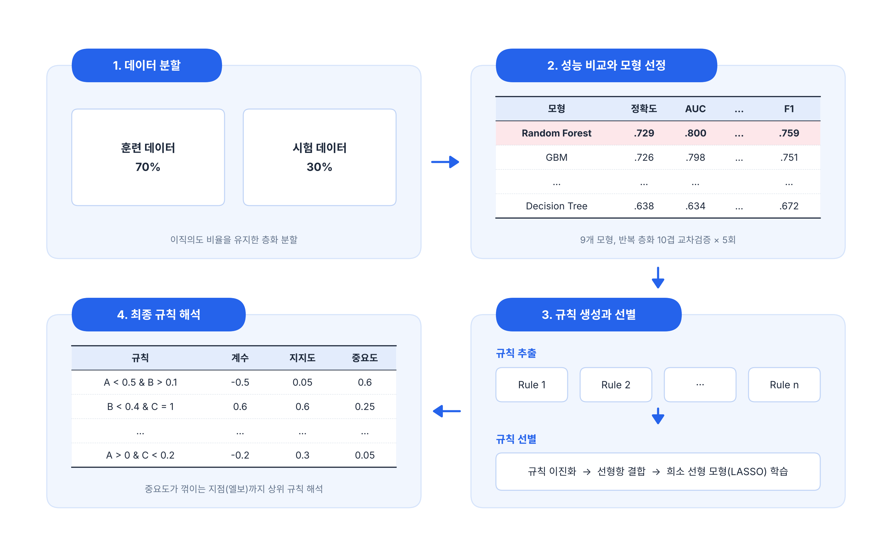
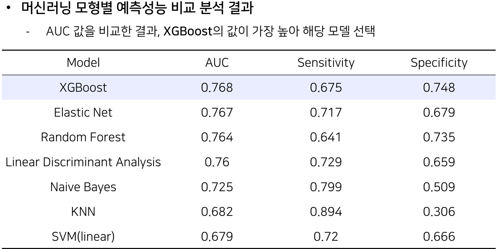
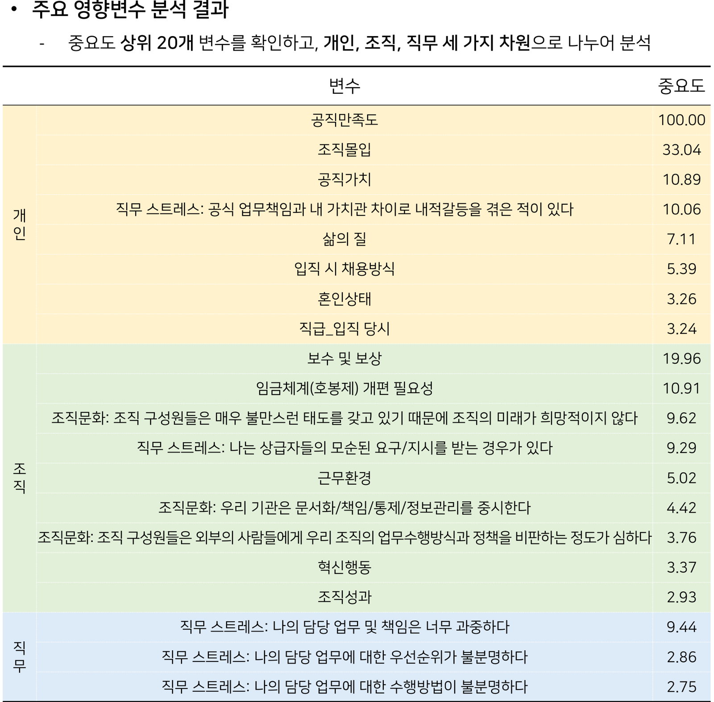
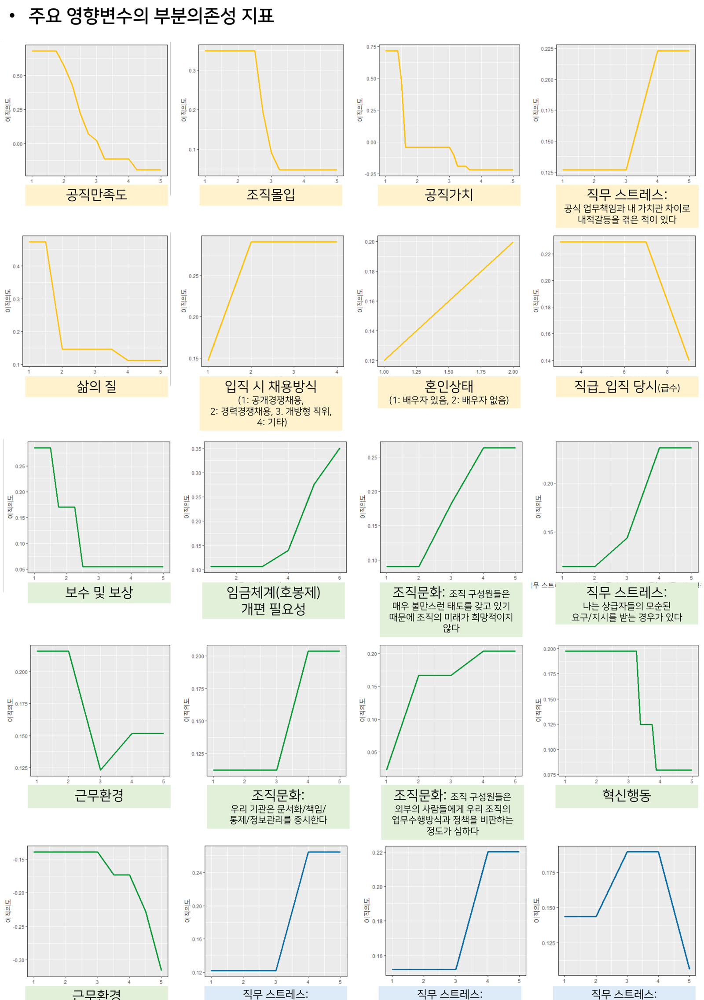
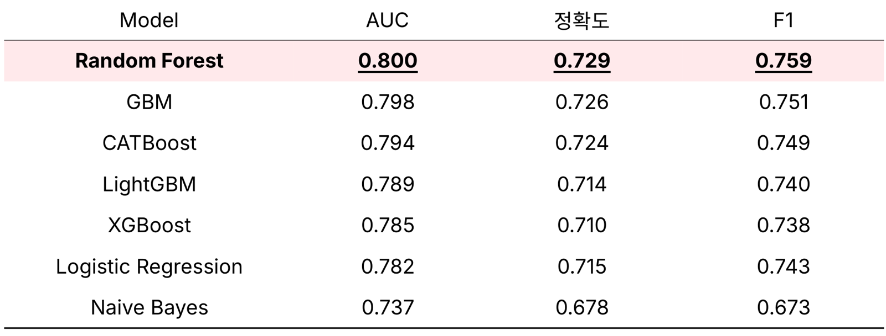
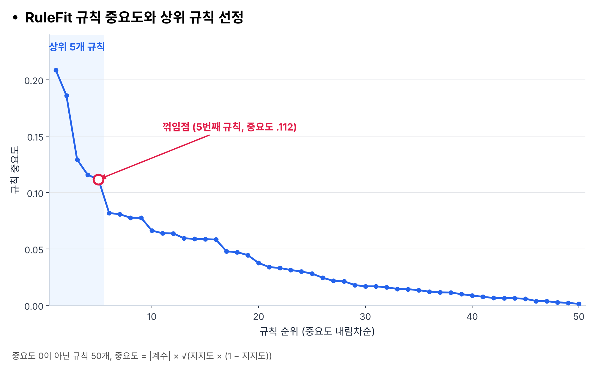

# MZ세대 공무원의 이직의도 예측

공직생활실태조사로 MZ세대 공무원의 이직의도를 예측하고 영향 요인을 해석한 머신러닝 분석 코드

## 개요

| 단계 | 자료 | 방법 | 성과 |
|---|---|---|---|
| 2024 포스터 | 2022 공직생활실태조사, MZ세대(1980년 이후 출생) 3,736명 | caret 알고리즘 비교, 스태킹 앙상블, 변수 중요도 | 한국산업및조직심리학회 동계학술대회 (2024.02) |
| 2025 논문 | 2024 공직생활실태조사, MZ세대(1981년 이후 출생) 4,142명 | PyCaret 모형 비교, 랜덤 포레스트 튜닝, RuleFit 규칙 추출 | 사회과학연구논총 (2025), 한국심리학회 연차학술대회 (2025) |

## 방법 설명

- **스태킹 앙상블**: 여러 모형의 예측값을 다시 입력으로 써서 최종 예측을 만드는 방법
- **랜덤 포레스트**: 의사결정나무 여러 개의 예측을 모아 최종 예측을 내는 머신러닝 모형
- **RuleFit**: 트리 모형에서 "조건 A 그리고 조건 B" 형태의 규칙을 뽑고, 규칙마다 결과에 미치는 영향을 계수로 추정하는 해석 가능한 모형

## 2024: 머신러닝을 활용한 이직의도 예측요인 분석

1. 범주형 변수와 중복 변수 제거, 부정 문항 역코딩, 요인별 문항 평균 계산
2. 이직의도를 이진 변수(분류)와 연속 변수(회귀)로 각각 설정
3. `caretList`로 kNN, 나이브 베이즈, 로지스틱 회귀, glmnet, LDA, QDA, SVM(선형, 방사형, 다항), 랜덤 포레스트, XGBoost를 같은 10겹 교차검증 폴드로 학습, ROC(분류)와 RMSE(회귀)로 비교
4. 모형 간 예측 상관(`modelCor`)으로 스태킹 앙상블 구성 검토, 선택한 모형으로 주요 영향변수 해석

| 파일 | 내용 |
|---|---|
| `code/2024_ksiop_caret/preprocess_2022.R` | 공통 전처리: MZ세대 선택, 제외 문항 정리, 역문항, 요인 점수 |
| `code/2024_ksiop_caret/01_classification.Rmd` | 이직의도(있음/없음) 분류 모형 11개 비교 |
| `code/2024_ksiop_caret/02_regression.Rmd` | 이직의도(5점 척도) 회귀 모형 8개 비교 |

**회귀 모형 재실행 결과** ([`02_regression.md`](code/2024_ksiop_caret/02_regression.md), 학습 2,803명, 평가 933명)

| 모형 | 평가 RMSE | 평가 R² | 교차검증 RMSE 평균 |
|---|---|---|---|
| glmnet | .885 | .336 | .917 |
| SVM(다항) | .887 | .334 | .923 |
| SVM(선형) | .889 | .329 | .934 |
| 선형회귀(glm) | .890 | .322 | .923 |
| SVM(방사형) | .893 | .327 | .925 |
| 랜덤 포레스트 | .894 | .325 | .923 |
| XGBoost | .901 | .305 | .922 |
| kNN | 1.001 | .169 | 1.009 |

- kNN을 뺀 7개 모형의 성능 차이가 작아 선형 모형(glmnet)으로도 비선형 모형과 비슷한 설명력 확보

## 2025: RuleFit 기반 설명가능 인공지능(XAI)

- 블랙박스 모형의 변수 중요도만으로는 "어떤 조건의 공무원이 이직의도가 높은가"를 설명하기 어려움
- 결과가 "공직만족 ≤ x 그리고 업무 과중 > y" 같은 규칙 형태로 나와 해석이 쉬운 RuleFit 선택

1. MZ세대 선별, 분석에 쓰지 않는 문항 제거, 역문항 처리, 요인별 문항 평균, 이직의도 이진화
2. 신뢰도(Cronbach's α), 기술통계, 상관 확인
3. PyCaret으로 분류 모형 9개를 반복 층화 10겹 교차검증 5회(총 50개 분할)로 비교, 모형별 AUC 기준 튜닝 후 평균, 표준편차, 표준오차 비교
4. 랜덤 포레스트를 같은 분할 조건에서 튜닝
5. 튜닝한 랜덤 포레스트와 같은 하이퍼파라미터로 트리를 만들어 RuleFit 적합, 계수와 지지도(support)를 함께 반영한 중요도로 규칙 정렬
6. 중요도가 급격히 꺾이는 지점(엘보) 기준 상위 5개 규칙 해석

| 파일 | 내용 |
|---|---|
| `code/2025_rulefit/rulefit_turnover.ipynb` | 전처리부터 모형 비교, RuleFit 규칙 추출과 상위 규칙 선정까지 (출력 결과는 제외) |

## 주요 결과

- 2024 포스터
  - 7개 모형 중 XGBoost의 AUC가 가장 높음 (.768)
  - 중요도 상위 변수: 공직만족도, 조직몰입, 보수 및 보상, 임금체계(호봉제) 개편 필요성, 공직가치
- 2025 논문
  - 랜덤 포레스트가 가장 높은 성능 (정확도 .729, AUC .800, 로지스틱 회귀 AUC .782)
  - 최상위 규칙: 공직만족도 ≤ 2.6이면서 자녀가 없으면 이직의도 증가 (응답자의 약 32% 해당)
  - 공직만족과 직무만족이 모두 높으면 이직의도 감소
  - 응답자의 절반 이상이 이직 계획은 없지만 조직 헌신이 낮은 "소극적 잔류자"

**2024: 모형 비교**

**2024: 변수 중요도 상위 20개** (개인, 조직, 직무 차원)

**2024: 주요 변수의 부분의존도**

**2025: 모형 비교**

**2025: 규칙 중요도와 엘보 지점** (상위 5개 규칙 선정)

- 그림 출처: 2024 한국산업및조직심리학회 동계학술대회 포스터, 2025 제79차 한국심리학회 연차학술대회 포스터, 신연우, 김진영, 이태헌 (2025). *사회과학연구논총*, 41(2), 195-241.

## 자료

- 한국행정연구원 공직생활실태조사 2022, 2024 (원자료는 비공개, 한국행정연구원 사회과학데이터센터에서 신청 가능)
- 실행 시 필요한 파일: `raw_data.csv`(2022, `code/2024_ksiop_caret`에 위치), `gong2024.csv`(2024, `code/2025_rulefit`에 위치)

## 성과

- 김진영, 이태헌 (2024). 머신러닝을 활용한 MZ세대 공무원의 이직의도 예측요인 분석. 한국산업및조직심리학회 동계학술대회 포스터. **우수 학술 논문상**
- 김진영, 신진영, 이태헌 (2024.04). M세대와 Z세대 공무원의 이직의도 예측 요인 비교: 머신러닝 기법의 적용. 한국심리측정평가학회 춘계학술대회 포스터.
- 신연우, 김진영, 이태헌 (2025). MZ세대 공무원의 이직의도 분석: RuleFit 기반 설명가능 인공지능(XAI)을 중심으로. *사회과학연구논총*, 41(2), 195-241.
- 김진영, 신진영, 이태헌 (2025.08). MZ세대 공무원의 이직의도 분석: RuleFit 기반 설명가능 인공지능(XAI)을 중심으로. 제79차 한국심리학회 연차학술대회(측정평가) 포스터.
- 신연우, 김진영, 이태헌 (2025.11). MZ세대 공무원의 이직의도 분석: RuleFit 기반 설명가능 인공지능(XAI)를 중심으로. 한국심리측정평가학회 추계학술대회 구두 발표.

## 참여

- 2024 포스터: 김진영, 이태헌
- 2025 논문: 신연우(1저자), 김진영, 이태헌
- 김진영: 분석, 해석, 원고 작성 등 연구 실무 전반
