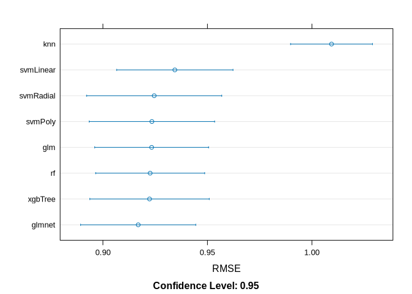

- `01_classification.Rmd`와 같은 자료, 이직의도는 이진 변수 대신 원래
  5점 척도(q38) 사용

- 회귀 모형 8개의 예측 성능 비교

- 필요한 파일: `raw_data.csv` (2022 공직생활실태조사),
  `preprocess_2022.R`

- 만드는 파일: `data_regression.csv`

## 1. 준비

``` r
library(caret)
```

``` r
library(caretEnsemble)
```

``` r
library(doParallel)
library(glmnet); library(e1071); library(randomForest); library(xgboost)
```

``` r
registerDoParallel(detectCores())
source("preprocess_2022.R")
```

## 2. 자료 준비

``` r
raw_data <- read.csv("raw_data.csv")
data <- preprocess_2022(raw_data)
```

    ## 결측 제거 전후 사례 수: 3736 → 3736

``` r
data$y   <- data$q38  # 이직의도 (1~5점)
data$q38 <- NULL
dim(data)
```

    ## [1] 3736   75

``` r
write.csv(data, "data_regression.csv", row.names = FALSE)

set.seed(1)
train_idx  <- createDataPartition(data$y, p = 0.75, list = FALSE)
train_data <- data[train_idx, ]
test_data  <- data[-train_idx, ]
dim(train_data)
```

    ## [1] 2803   75

``` r
dim(test_data)
```

    ## [1] 933  75

## 3. 모형 학습

``` r
set.seed(1)
my_folds <- createFolds(train_data$y, k = 10, returnTrain = TRUE)

stack_control <- trainControl(
  method = "cv", number = 10,
  index  = my_folds,  # 모든 모형이 같은 10겹 폴드를 쓰도록 고정
  savePredictions = "all",
  allowParallel = TRUE
)

model_list <- c("knn", "glm", "glmnet", "svmLinear", "svmRadial", "svmPoly", "rf", "xgbTree")

fit <- caretList(y ~ ., data = train_data,
                 methodList = model_list,
                 trControl  = stack_control,
                 metric     = "RMSE",
                 preProcess = c("center", "scale"))
```

    ## Warning in randomForest.default(x, y, mtry = param$mtry, ...): The response has
    ## five or fewer unique values.  Are you sure you want to do regression?

``` r
fit
lapply(fit, function(m) m$bestTune)
```

## 4. 성능 비교

``` r
# 평가 자료 RMSE, R², MAE
test_pred <- sapply(fit, function(m) predict(m, newdata = test_data))
t(apply(test_pred, 2, function(p) postResample(p, test_data$y)))
```

    ##                RMSE  Rsquared       MAE
    ## knn       1.0005270 0.1691161 0.8253900
    ## glm       0.8900115 0.3223119 0.7245167
    ## glmnet    0.8845194 0.3355254 0.7234046
    ## svmLinear 0.8892182 0.3294455 0.7162207
    ## svmRadial 0.8929864 0.3268708 0.7006442
    ## svmPoly   0.8866881 0.3341787 0.7108188
    ## rf        0.8936616 0.3247105 0.7299437
    ## xgbTree   0.9011052 0.3053507 0.7258304

``` r
# 교차검증 성능
rs <- resamples(fit)
summary(rs)
```

    ## 
    ## Call:
    ## summary.resamples(object = rs)
    ## 
    ## Models: knn, glm, glmnet, svmLinear, svmRadial, svmPoly, rf, xgbTree 
    ## Number of resamples: 10 
    ## 
    ## MAE 
    ##                Min.   1st Qu.    Median      Mean   3rd Qu.      Max. NA's
    ## knn       0.7884921 0.7979954 0.8250198 0.8251123 0.8362897 0.8924081    0
    ## glm       0.6910414 0.7084115 0.7295945 0.7316902 0.7421244 0.7932911    0
    ## glmnet    0.6877224 0.7048027 0.7270207 0.7284820 0.7354282 0.7935557    0
    ## svmLinear 0.6903264 0.7067755 0.7326373 0.7323160 0.7494540 0.7890698    0
    ## svmRadial 0.6672563 0.6831539 0.7099847 0.7123651 0.7344665 0.7711376    0
    ## svmPoly   0.6744051 0.6996275 0.7171092 0.7204079 0.7333977 0.7801348    0
    ## rf        0.6940905 0.7139175 0.7362779 0.7395400 0.7451091 0.8051899    0
    ## xgbTree   0.6737766 0.7012303 0.7396751 0.7302969 0.7436109 0.7938790    0
    ## 
    ## RMSE 
    ##                Min.   1st Qu.    Median      Mean   3rd Qu.      Max. NA's
    ## knn       0.9813818 0.9861289 1.0052316 1.0093584 1.0199766 1.0586320    0
    ## glm       0.8729652 0.9011722 0.9143033 0.9233041 0.9587495 0.9776913    0
    ## glmnet    0.8655827 0.8950192 0.9125576 0.9168712 0.9513591 0.9728075    0
    ## svmLinear 0.8776398 0.9142106 0.9333566 0.9343972 0.9648064 0.9866098    0
    ## svmRadial 0.8697197 0.8868904 0.9307272 0.9245179 0.9523628 1.0110061    0
    ## svmPoly   0.8609567 0.9093579 0.9163749 0.9234183 0.9543455 0.9890632    0
    ## rf        0.8636614 0.8965310 0.9223237 0.9225956 0.9472814 0.9809255    0
    ## xgbTree   0.8739443 0.8832975 0.9272772 0.9222962 0.9579276 0.9749721    0
    ## 
    ## Rsquared 
    ##                Min.   1st Qu.    Median      Mean   3rd Qu.      Max. NA's
    ## knn       0.1208434 0.1525739 0.1795762 0.1741970 0.2026555 0.2179874    0
    ## glm       0.2124779 0.2604742 0.2864063 0.2857587 0.3174985 0.3309056    0
    ## glmnet    0.2197415 0.2666944 0.2958727 0.2943192 0.3298247 0.3399943    0
    ## svmLinear 0.2090485 0.2631068 0.2852995 0.2782994 0.3024289 0.3172753    0
    ## svmRadial 0.2221839 0.2658325 0.3012187 0.2923639 0.3206289 0.3368505    0
    ## svmPoly   0.2206038 0.2728785 0.2937221 0.2894942 0.3187358 0.3351553    0
    ## rf        0.2117055 0.2563231 0.2931008 0.2882581 0.3191218 0.3486342    0
    ## xgbTree   0.2102781 0.2599247 0.2917189 0.2847618 0.3171293 0.3304815    0

``` r
dotplot(rs, metric = "RMSE")
```

<!-- -->
